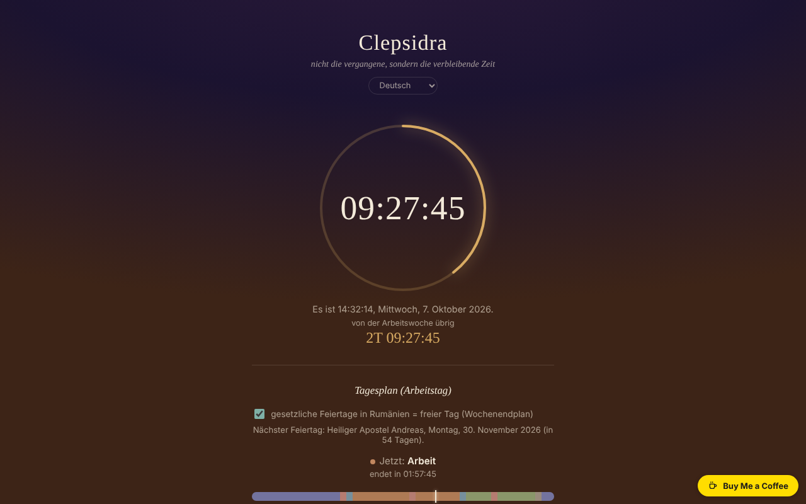

# CLEPSIDRA

[English](README.md) · [Română](README.ro.md) · [Français](README.fr.md) · [Italiano](README.it.md) · [Español](README.es.md) · [Português](README.pt.md) · **Deutsch** · [Magyar](README.hu.md)

**Version:** 2.0.1 · **Zuletzt aktualisiert:** 2026-10-27

**Status:** stabil · **Offline:** vollständig

Oberflächensprachen: **Română, English, Français, Italiano, Español, Português (PT), Deutsch, Magyar**

Umgekehrte Uhr: nicht die vergangene Zeit, sondern die verbleibende Zeit des Tages und der Woche, dazu ein Wecker und Zeitpläne für Werktage und Wochenende.

**Online:** https://chiuta.github.io/CLEPSIDRA/

## Was es ist

Eine einzige HTML-Datei ohne externe Abhängigkeiten, mit einer Oberfläche in 8 Sprachen. Sie zeigt, wie viel Zeit bis Mitternacht bleibt, wie viel von der Arbeitswoche (oder vom Wochenende) übrig ist, welche Aktivität „jetzt" nach deinem Zeitplan ansteht und wie viele Stunden heute in jeder Kategorie noch bleiben. Sie geht „von einem Gedanken aus dem Buch Nemurirea über die biologische Uhr" aus.

## Clepsidra, Clopoțel oder Orar? Der Unterschied

Drei Schwester-Apps mit unterschiedlichen Zwecken. Sie tauschen untereinander keine Daten aus.

- **CLEPSIDRA**: zeigt, wie viel Zeit bleibt (vom Tag, von der Arbeitswoche oder vom Wochenende), mit persönlichem Tagesplan, Terminen, Wecker und Timer-Routinen. Sie ist für eine einzelne Person und deren eigenen Tag gedacht.
- **[Clopoțel](https://chiuta.github.io/Clopotel/)**: Bühnen-Timer mit Glocke für Konferenzen: begrenzt die Zeit jedes Redners der Agenda und hat eine Bühnenanzeige.
- **[Orar](https://chiuta.github.io/Orar/)**: Kalender und Wochenplan (Monat / Woche / Tag / Agenda) mit Terminen, Serien im Stil von RFC 5545, ISO-Wochen und Feiertagen; für längerfristige Planung.

## Funktionen

Im Code und in automatisierten Tests geprüft (Headless-Chromium, simulierte Uhr, Zeitzone Europe/Bucharest):
- Countdown bis zur nächsten Mitternacht, berechnet auf dem lokalen Kalender: An Tagen mit Zeitumstellung dauern die Tage 23 oder 25 Stunden, und der Countdown bildet das ab.
- Countdown bis zum Ende der Arbeitswoche (Samstag 00:00) oder des Wochenendes (Montag 00:00). Das Wochenende ist fest Samstag–Sonntag; gesetzliche Feiertage in Rumänien werden als freie Tage behandelt (Kontrollkästchen „gesetzliche Feiertage", standardmäßig aktiv, abschaltbar), mit Anzeige des nächsten Feiertags und seines Namens.
- Getrennter Zeitplan für Werktage und Wochenende, mit sechs Kategorien (Schlaf, Fahrtzeit, Arbeit, Mahlzeiten, Freizeit, Sonstiges), Tagesleiste, „jetzt" und verbleibender Zeit pro Kategorie; Intervall-Editor (auch über Mitternacht hinweg). Der Editor warnt bei überlappenden Intervallen; ein Intervall mit Beginn = Ende wird ignoriert.
- Ereignisse: bis zu 6 Countdowns zu einem von dir gewählten Datum und einer Uhrzeit (Name bis 40 Zeichen), chronologisch sortiert, mit der verbleibenden Zeit in 24-Stunden-Tagen (`z`) und `HH:MM:SS`; vergangene Ereignisse bleiben mit „vor … vergangen" sichtbar, bis du sie löschst. Validierung mit Meldungen (fehlender Name, fehlendes Datum, Grenze von 6).
- Wecker zu einer gewählten Uhrzeit, mit der Option „täglich wiederholen", Ton, der bis „stopp" wiederholt wird, visuellem Blitz und Browser-Benachrichtigung (sofern erlaubt).

## Neue Funktionen (1.1.0)

- **Kalenderexport (.ics)** für: den Tageszeitplan (Werktage / Wochenende, wöchentliche Wiederholung, Uhrzeiten als „schwebende Zeiten", mit Ausnahmen für die gesetzlichen Feiertage Rumäniens über 12 Monate), deine Ereignisse (mit einer Erinnerung 15 Minuten vorher) und den Wecker (tägliche Wiederholung, wenn „täglich wiederholen" angehakt ist). Die Dateien wurden mit der Python-Bibliothek `icalendar` und mit einer unabhängigen Berechnung des orthodoxen Osterdatums geprüft.
- **Drucken / PDF des Zeitplans**: Die Drucktaste bereitet ein Blatt mit den beiden Zeitplänen (Werktage und Wochenende) und der Ereignisliste vor; der Rest der Seite wird nicht gedruckt.
- Sicherung als `.fff.json` (gemeinsamer „fff-kit"-Modus, lokal, ohne Netzwerk): wird über den Dialog geöffnet, der beim Klick auf die Version im Fußbereich erscheint (Export, passwortverschlüsselter Export, Import mit Bestätigung, Löschen der App-Daten). Die Sicherung umfasst die Schlüssel `clepsidra.*`.
- Die Oberfläche hat 8 Sprachen (RO, EN, FR, IT, ES, PT, DE, HU); die Übersetzungen außer Rumänisch sind automatisch und nicht von Muttersprachlern geprüft.

## Bedienungsanleitung

1. Öffne die Seite; die Uhr startet von selbst.
2. Für den Zeitplan: Drücke „Zeitplan bearbeiten", wähle den Reiter „Werktage" oder „Wochenende", ändere die Uhrzeiten und Kategorien oder füge Intervalle hinzu/lösche sie. Änderungen werden automatisch im Browser gespeichert.
3. Für den Wecker: Wähle die Uhrzeit, hake „täglich wiederholen" an oder nicht und drücke „aktivieren" (bei diesem Klick kann der Browser um die Erlaubnis für Benachrichtigungen bitten und aktiviert den Ton).
4. Wenn der Wecker klingelt, drücke „stopp".

## Datenschutz und Netzwerk

- Es wird keine Netzwerkanfrage gestellt; die Datei lädt keine externen Ressourcen (sie hat zudem eine restriktive CSP-Richtlinie) und hat keine Telemetrie.
- Lokaler Speicher (`localStorage`): `clepsidra.schedule` (die Zeitpläne) und `clepsidra.alarm` (Weckzeit, Wiederholung, aktiv) und `clepsidra.holidays` (das Feiertags-Kontrollkästchen) und `clepsidra.events` (die Ereignisse). Die Daten im Speicher werden beim Laden validiert; ist der Speicher blockiert, funktioniert die App, behält die Einstellungen aber nicht. Die Schlüssel `clepsidra.schedule` und `clepsidra.events` werden absichtlich geteilt: Die App Orar liest sie (nur lesend), um die Stundenpläne und Countdowns zu importieren; CLEPSIDRA schreibt nie in die Schlüssel von Orar (`fff.orar.*`).
- Die `.ics`-Exporte und die `.fff.json`-Sicherung werden im Browser erzeugt und nur beim Drücken der Tasten heruntergeladen; sie enthalten keine Daten außer den oben genannten.
- Berechtigungen: Benachrichtigungen (nur beim Klick auf „aktivieren" angefordert) und Ton.

## Grenzen und Hinweise

- **Der Wecker funktioniert nur, solange die Seite geöffnet und aktiv bleibt.** Bei einem Tab im Hintergrund verlangsamen Browser die Timer; auf dem Handy mit gesperrtem Bildschirm oder bei geschlossener Seite kann der Wecker verspätet oder gar nicht klingeln (die App sagt das auch in der Oberfläche; fängt sie den Wecker verspätet ab, zeigt sie „vor N Min." an). Nutze ihn nicht als einzigen Wecker für wichtige Dinge.
- War die Seite zum Zeitpunkt des Weckers geschlossen, klingelt er beim erneuten Öffnen nicht; er wird für das nächste Auftreten der Uhrzeit neu geplant.
- Unter iOS/Safari ist Ton nur nach einer Nutzergeste erlaubt: Deshalb wird der Ton beim Drücken von „aktivieren" freigeschaltet. Auf echten iOS-Geräten konnte ich nicht testen.
- Die Feiertagsliste folgt der Gesetzgebung zum Prüfdatum und kann veralten, wenn sich das Gesetz ändert; freie Tage anderer Religionsgemeinschaften oder durch einzelne Beschlüsse gewährte (Brückentage) sind nicht enthalten.
- Der Standardzeitplan ist ein Beispiel; ändere ihn nach Bedarf. An Tagen mit Zeitumstellung wird die Tagesleiste auf die tatsächliche Dauer skaliert (23/25 h), die Beschriftungen 00–24 bleiben jedoch fest.

## Lokale Ausführung / offline

Lade `index.html` herunter und öffne sie im Browser; sie funktioniert vollständig ohne Internet.

## Verlauf / Changelog

### 1.2.3 — 2026-10-22
- fff-kit 1.1.4: Touch-Ziele und Mindestschriftgröße

### 1.2.2 — 2026-10-22
- fff-kit 1.1.2: PBKDF2 mit 600.000 Iterationen, Schutz vor Clickjacking

### 14. Oktober 2026 (v1.1.0)
- `.ics`-Export (Zeitplan, Ereignisse, Wecker), Druck-/PDF-Blatt des Zeitplans.
- `.fff.json`-Sicherung über die gemeinsamen Module (core, label, bundle); neue Tests: `tests/fff-r8.test.mjs` und `tests/ics_check.py` (unabhängige Prüfung; benötigt das Python-Paket `icalendar`).

### 12. Oktober 2026 (v1.0.0)
- 1.2.1 — 2026-10-22: die schwebende Buy-Me-a-Coffee-Schaltfläche verdeckt auf schmalen Bildschirmen keine Steuerelemente mehr (sie steht im Seitenfluss); Kontrollkästchen mit 24 px; die PRODID exportierter `.ics`-Dateien folgt der App-Version; die mit Orar geteilten Schlüssel sind dokumentiert (beabsichtigt, auf Orar-Seite nur lesend). Feinschliff für Mobilgeräte und Barrierefreiheit: Text mit mindestens 12 px und Touch-Ziele von mindestens 24 px.
- 1.0.0 — 2026-10-12: Version und Datum der letzten Aktualisierung werden in der App angezeigt

### 11. Oktober 2026 (zweiter Eintrag)
- Neue Funktion: „Ereignisse" — Countdowns zu vom Nutzer gewählten Daten, lokal gespeichert (getestet: Validierung, Hinzufügen, Sortierung, Vergangenes, Löschen, Persistenz beim Neuladen, Grenze von 6).

### 11. Oktober 2026
- Prüfung vom 11. Oktober 2026: axe 0 Verstöße, keine Konsolenfehler, kein horizontaler Überlauf bei 360 px; die Countdowns werden dynamisch aus der lokalen Uhr berechnet (einschließlich der Zeitumstellung vom 25. Oktober 2026), enthalten also keine veralteten festen Daten.
- Neu: Die gesetzlichen Feiertage Rumäniens (am 11. Oktober 2026 geprüfte Liste im Arbeitsgesetzbuch Art. 139 und in einer Liste für 2026; orthodoxes Ostern nach dem Meeus-Algorithmus berechnet, +13 Tage) zählen im Wochen-Countdown als freie Tage; Kontrollkästchen zum Abschalten, Zeile „nächster Feiertag". Screenshot aktualisiert.

## Lizenz

MIT-Lizenz — siehe Datei `LICENSE`.

## Autor

Alexio — Alexandru-Ionuț Chiuță, Kontakt: alexio@trom.tf

## Zusammenfassung

CLEPSIDRA ist eine „umgekehrte Uhr" in einer einzigen Datei, mit einer Oberfläche in 8 Sprachen: verbleibende Zeit des Tages und der Arbeitswoche/des Wochenendes, ein Tageszeitplan mit getrennten Vorlagen für Werktage und Wochenende sowie ein Wecker. Tage mit Zeitumstellung (23/25 h) werden über die Kalendermitternacht behandelt. Keine Netzwerkanfragen, keine Telemetrie; Einstellungen werden in localStorage gehalten und beim Laden validiert. Der Wecker funktioniert nur, solange die Seite geöffnet und aktiv ist (die App ist dazu in der Oberfläche ehrlich). Lizenz noch nicht festgelegt.
