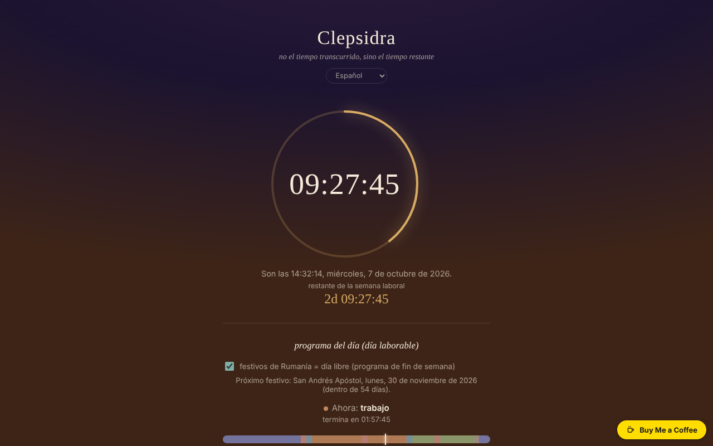

# CLEPSIDRA

[English](README.md) · [Română](README.ro.md) · [Français](README.fr.md) · [Italiano](README.it.md) · **Español** · [Português](README.pt.md) · [Deutsch](README.de.md) · [Magyar](README.hu.md)

**Versión:** 1.2.4 · **Última actualización:** 2026-10-23

Idiomas de la interfaz: **Română, English, Français, Italiano, Español, Português (PT), Deutsch, Magyar**

Reloj inverso: no el tiempo transcurrido, sino el tiempo que queda del día y de la semana, además de una alarma y horarios para los días laborables y el fin de semana.

**En línea:** https://chiuta.github.io/CLEPSIDRA/

## Qué es

Un único archivo HTML, sin dependencias externas, con interfaz en 8 idiomas. Muestra cuánto falta para la medianoche, cuánto queda de la semana laboral (o del fin de semana), qué actividad toca «ahora» según tu horario y cuántas horas quedan hoy de cada categoría. Parte «de un pensamiento del libro Nemurirea, sobre el reloj biológico».

## Funciones

Verificadas en el código y en pruebas automáticas (Chromium sin interfaz, reloj simulado, zona horaria Europe/Bucharest):
- Cuenta atrás hasta la próxima medianoche, calculada sobre el calendario local: en los días con cambio de hora los días duran 23 o 25 horas y la cuenta atrás lo refleja.
- Cuenta atrás hasta el final de la semana laboral (sábado 00:00) o del fin de semana (lunes 00:00). El fin de semana es fijo, sábado–domingo; los días festivos legales de Rumanía se tratan como días libres (casilla «festivos legales», activada por defecto, se puede desactivar), mostrando el próximo festivo y su nombre.
- Horario separado para los días laborables y el fin de semana, con seis categorías (sueño, desplazamiento, trabajo, comidas, tiempo libre, otros), barra del día, «ahora» y tiempo restante por categoría; editor de intervalos (incluidos los que cruzan la medianoche). El editor avisa de los intervalos solapados; un intervalo con inicio = fin se ignora.
- Eventos: hasta 6 cuentas atrás hacia una fecha y una hora que elijas (nombre de hasta 40 caracteres), ordenadas cronológicamente, con el tiempo restante en días de 24 horas (`z`) y `HH:MM:SS`; los eventos pasados siguen mostrándose con «pasó hace …» hasta que los elimines. Validación con mensajes (falta el nombre, falta la fecha, límite de 6).
- Alarma a una hora elegida, con la opción «repetir a diario», sonido repetido hasta «detener», destello visual y notificación del navegador (si lo permites).

## Novedades (1.1.0)

- **Exportación de calendario (.ics)** de: el horario del día (días laborables / fin de semana, repetición semanal, horas como «horas flotantes», con excepciones para los festivos legales de Rumanía durante 12 meses), tus eventos (con un recordatorio 15 minutos antes) y la alarma (repetición diaria si «repetir a diario» está marcado). Los archivos se verificaron con la biblioteca de Python `icalendar` y con un cálculo independiente de la Pascua ortodoxa.
- **Impresión / PDF del horario**: el botón de impresión prepara una hoja con los dos horarios (días laborables y fin de semana) y la lista de eventos; el resto de la página no se imprime.
- Copia de seguridad `.fff.json` (modo común «fff-kit», local, sin red): se abre desde el cuadro de diálogo que aparece al hacer clic en la versión del pie de página (exportación, exportación cifrada con contraseña, importación con confirmación, borrado de los datos de la aplicación). La copia abarca las claves `clepsidra.*`.
- La interfaz tiene 8 idiomas (RO, EN, FR, IT, ES, PT, DE, HU); las traducciones distintas del rumano son automáticas y no están verificadas por hablantes nativos.

## Guía de uso

1. Abre la página; el reloj arranca solo.
2. Para el horario: pulsa «editar horario», elige la pestaña «días laborables» o «fin de semana», modifica las horas y las categorías o añade/elimina intervalos. Los cambios se guardan automáticamente en el navegador.
3. Para la alarma: elige la hora, marca o no «repetir a diario» y pulsa «activar» (con este clic el navegador puede pedir permiso para las notificaciones y activa el sonido).
4. Cuando suene la alarma, pulsa «detener».

## Privacidad y red

- No se realiza ninguna solicitud de red; el archivo no carga recursos externos (además tiene una política CSP restrictiva) y no tiene telemetría.
- Almacenamiento local (`localStorage`): `clepsidra.schedule` (los horarios) y `clepsidra.alarm` (hora de la alarma, repetición, activa) y `clepsidra.holidays` (la casilla de festivos legales) y `clepsidra.events` (los eventos). Los datos del almacenamiento se validan al cargar; si el almacenamiento está bloqueado, la aplicación funciona pero no conserva los ajustes. Las claves `clepsidra.schedule` y `clepsidra.events` se comparten a propósito: la aplicación Orar las lee (solo lectura) para importar los horarios y las cuentas atrás; CLEPSIDRA nunca escribe en las claves de Orar (`fff.orar.*`).
- Las exportaciones `.ics` y la copia `.fff.json` se generan en el navegador y se descargan solo al pulsar los botones; no contienen datos distintos de los indicados arriba.
- Permisos: notificaciones (solicitadas solo al hacer clic en «activar») y sonido.

## Límites y advertencias

- **La alarma solo funciona mientras la página permanezca abierta y activa.** Con la pestaña en segundo plano los navegadores ralentizan los temporizadores; en el teléfono con la pantalla bloqueada o con la página cerrada, la alarma puede sonar con retraso o no sonar (la aplicación lo dice también en la interfaz; si detecta la alarma tarde, muestra «hace N min»). No la uses como única alarma para cosas importantes.
- Si la página estaba cerrada en el momento de la alarma, esta no suena al reabrirla; se reprograma para la siguiente aparición de la hora.
- En iOS/Safari el sonido solo se permite tras un gesto del usuario: por eso el sonido se activa al pulsar «activar». No he podido probarlo en dispositivos iOS reales.
- La lista de festivos sigue la legislación en la fecha de verificación y puede quedar obsoleta si cambia la ley; no se incluyen los días libres de otros cultos ni los concedidos por decisiones puntuales (puentes).
- El horario predeterminado es un ejemplo; cámbialo según necesites. En los días con cambio de hora la barra del día se escala a la duración real (23/25 h), pero las etiquetas 00–24 permanecen fijas.

## Ejecución local / sin conexión

Descarga `index.html` y ábrelo en un navegador; funciona por completo sin internet.

## Historial / Changelog

### 1.2.3 — 2026-10-22
- fff-kit 1.1.4: objetivos táctiles y tamaño mínimo de texto

### 1.2.2 — 2026-10-22
- fff-kit 1.1.2: PBKDF2 600 000 iteraciones, protección anti-clickjacking

### 14 de octubre de 2026 (v1.1.0)
- Exportación `.ics` (horario, eventos, alarma), hoja de impresión / PDF del horario.
- Copia `.fff.json` mediante los módulos comunes (core, label, bundle); nuevas pruebas: `tests/fff-r8.test.mjs` y `tests/ics_check.py` (verificación independiente; requiere el paquete de Python `icalendar`).

### 12 de octubre de 2026 (v1.0.0)
- 1.2.1 — 2026-10-22: el botón flotante Buy Me a Coffee ya no tapa los controles en pantallas estrechas (está en el flujo de la página); casillas de 24 px; el PRODID de los `.ics` exportados sigue la versión de la aplicación; las claves compartidas con Orar están documentadas (intencionado, solo lectura por parte de Orar). mejoras para móvil y accesibilidad: texto de al menos 12 px y áreas táctiles de al menos 24 px.
- 1.0.0 — 2026-10-12: la versión y la fecha de la última actualización se muestran en la aplicación

### 11 de octubre de 2026 (segunda entrada)
- Función nueva: «eventos» — cuentas atrás hacia fechas elegidas por el usuario, guardadas en local (probado: validación, adición, ordenación, pasado, eliminación, persistencia al recargar, límite de 6).

### 11 de octubre de 2026
- Verificación del 11 de octubre de 2026: axe 0 infracciones, sin errores en la consola, sin desbordamiento horizontal a 360 px; las cuentas atrás se calculan dinámicamente a partir del reloj local (incluido el cambio de hora del 25 de octubre de 2026), por lo que no contienen fechas fijas obsoletas.
- Novedad: los festivos legales de Rumanía (lista verificada el 11 de octubre de 2026 en el Código del Trabajo art. 139 y en una lista de 2026; Pascua ortodoxa calculada con el algoritmo de Meeus, +13 días) cuentan como días libres en la cuenta atrás de la semana; casilla para desactivarlos, línea «próximo festivo». Captura de pantalla actualizada.

## Licencia

Licencia MIT — véase el archivo `LICENSE`.

## Autor

Alexio — Alexandru-Ionuț Chiuță, contacto: alexio@trom.tf

## Resumen

CLEPSIDRA es un «reloj inverso» de un solo archivo, con interfaz en 8 idiomas: tiempo restante del día y de la semana laboral/fin de semana, un horario diario con plantillas separadas para los días laborables y el fin de semana, y una alarma. Los días con cambio de hora (23/25 h) se gestionan mediante la medianoche del calendario. Sin solicitudes de red, sin telemetría; los ajustes se guardan en localStorage y se validan al cargar. La alarma solo funciona mientras la página está abierta y activa (la aplicación es sincera al respecto en la interfaz). Licencia aún no declarada.
