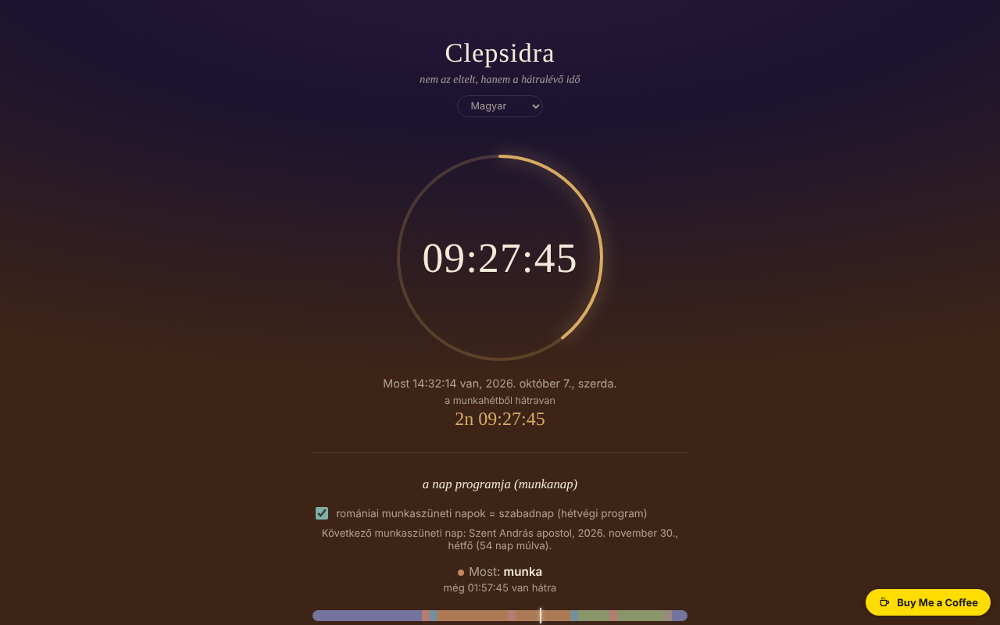

# CLEPSIDRA

[English](README.md) · [Română](README.ro.md) · [Français](README.fr.md) · [Italiano](README.it.md) · [Español](README.es.md) · [Português](README.pt.md) · [Deutsch](README.de.md) · **Magyar**

**Verzió:** 1.2.4 · **Utolsó frissítés:** 2026-10-23

A felület nyelvei: **Română, English, Français, Italiano, Español, Português (PT), Deutsch, Magyar**

Fordított óra: nem az eltelt időt, hanem a nap és a hét hátralévő idejét mutatja, ráadásul ébresztővel és a munkanapokra, illetve a hétvégére szóló napirenddel.

**Élő változat:** https://chiuta.github.io/CLEPSIDRA/

## Mi ez

Egyetlen HTML-fájl, külső függőségek nélkül, 8 nyelvű felülettel. Megmutatja, mennyi van még éjfélig, mennyi van hátra a munkahétből (vagy a hétvégéből), milyen tevékenység zajlik „most” a napirended szerint, és hány óra van még ma hátra az egyes kategóriákból. „A Nemurirea című könyv egy gondolatából indul ki, a biológiai óráról”.

## Funkciók

Kódban és automatizált tesztekben ellenőrizve (fej nélküli Chromium, szimulált óra, Europe/Bucharest időzóna):
- Visszaszámlálás a következő éjfélig, a helyi naptáron számolva: óraállítással érintett napokon a napok 23 vagy 25 órásak, és a visszaszámlálás ezt tükrözi.
- Visszaszámlálás a munkahét végéig (szombat 0:00) vagy a hétvége végéig (hétfő 0:00). A hétvége fixen szombat–vasárnap; Románia törvényes ünnepnapjai szabadnapként számítanak („törvényes ünnepnapok” jelölőnégyzet, alapértelmezés szerint bekapcsolva, kikapcsolható), a következő ünnepnap és a neve is megjelenik.
- Külön napirend munkanapokra és hétvégére, hat kategóriával (alvás, utazás, munka, étkezés, szabadidő, egyéb), napsávval, „most” jelzéssel és kategóriánkénti hátralévő idővel; intervallumszerkesztő (éjfélen átnyúló intervallumokkal is). A szerkesztő figyelmeztet az átfedő intervallumokra; az olyan intervallumot, amelynek kezdete = vége, figyelmen kívül hagyja.
- Események: legfeljebb 6 visszaszámlálás egy általad választott dátumig és időpontig (név legfeljebb 40 karakter), időrendben rendezve, a hátralévő idővel 24 órás napokban (`z`) és `HH:MM:SS` formában; a múltbeli események „… telt el” felirattal megmaradnak, amíg törlöd őket. Ellenőrzés üzenetekkel (hiányzó név, hiányzó dátum, 6-os korlát).
- Ébresztő a választott időpontra, „ismétlés naponta” lehetőséggel, a „leállítás”-ig ismétlődő hanggal, vizuális villogással és böngészőértesítéssel (ha engedélyezed).

## Újdonságok (1.1.0)

- **Naptárexport (.ics)** ezekhez: a napi napirend (munkanapok / hétvége, heti ismétlés, az időpontok „lebegő időként”, Románia törvényes ünnepnapjaira vonatkozó kivételekkel 12 hónapra), az eseményeid (15 perccel előtte emlékeztetővel) és az ébresztő (napi ismétlés, ha az „ismétlés naponta” be van jelölve). A fájlokat a Python `icalendar` könyvtárral és az ortodox húsvét független kiszámításával ellenőriztük.
- **A napirend nyomtatása / PDF-be mentése**: a nyomtatás gomb egy lapot készít elő a két napirenddel (munkanapok és hétvége) és az események listájával; az oldal többi része nem nyomtatódik.
- `.fff.json` biztonsági mentés (közös „fff-kit” mód, helyi, hálózat nélkül): a láblécben a verzióra kattintva megjelenő párbeszédablakból nyitható meg (exportálás, jelszóval titkosított exportálás, importálás megerősítéssel, az alkalmazásadatok törlése). A mentés a `clepsidra.*` kulcsokat tartalmazza.
- A felület 8 nyelvű (RO, EN, FR, IT, ES, PT, DE, HU); a romántól eltérő fordítások gépiek, és anyanyelvi beszélők nem ellenőrizték őket.

## Használati útmutató

1. Nyisd meg az oldalt; az óra magától elindul.
2. A napirendhez: nyomd meg a „napirend szerkesztése” gombot, válaszd a „munkanapok” vagy a „hétvége” lapot, módosítsd az időpontokat és a kategóriákat, vagy adj hozzá/törölj intervallumokat. A módosítások automatikusan mentődnek a böngészőben.
3. Az ébresztőhöz: válaszd ki az időpontot, jelöld be vagy ne az „ismétlés naponta” lehetőséget, és nyomd meg az „aktiválás” gombot (erre a kattintásra a böngésző értesítési engedélyt kérhet, és engedélyezi a hangot).
4. Amikor az ébresztő megszólal, nyomd meg a „leállítás” gombot.

## Adatvédelem és hálózat

- Nem történik hálózati kérés; a fájl nem tölt be külső erőforrásokat (szigorú CSP-szabályzata is van), és nincs benne telemetria.
- Helyi tárolás (`localStorage`): `clepsidra.schedule` (a napirendek) és `clepsidra.alarm` (az ébresztés ideje, ismétlés, aktív) és `clepsidra.holidays` (a törvényes ünnepnapok jelölőnégyzete) és `clepsidra.events` (az események). A tárolt adatokat betöltéskor ellenőrzi; ha a tárolás le van tiltva, az alkalmazás működik, de nem őrzi meg a beállításokat. A `clepsidra.schedule` és `clepsidra.events` kulcsokat szándékosan osztják meg: az Orar alkalmazás (csak olvasásra) innen importálja a napirendeket és a visszaszámlálásokat; a CLEPSIDRA soha nem ír az Orar kulcsaiba (`fff.orar.*`).
- Az `.ics` exportok és a `.fff.json` mentés a böngészőben jön létre, és csak a gombok megnyomásakor töltődik le; a fentieken kívül nem tartalmaz adatot.
- Engedélyek: értesítések (csak az „aktiválás” gombra kattintáskor kéri) és hang.

## Korlátok és figyelmeztetések

- **Az ébresztő csak addig működik, amíg az oldal nyitva és aktív marad.** Ha a lap a háttérben van, a böngészők lassítják az időzítőket; zárolt képernyőjű telefonon vagy bezárt oldal esetén az ébresztő késve vagy egyáltalán nem szólalhat meg (az alkalmazás ezt a felületen is közli; ha későn kapja el az ébresztést, „N perccel ezelőtt” feliratot jelenít meg). Ne használd egyetlen ébresztőként fontos dolgokhoz.
- Ha az oldal az ébresztés pillanatában be volt zárva, az ébresztő újranyitáskor nem szólal meg; a következő időpont-előfordulásra ütemeződik újra.
- iOS/Safari alatt a hang csak felhasználói művelet után engedélyezett: ezért a hangot az „aktiválás” megnyomásakor engedélyezi. Valódi iOS-eszközökön nem tudtam tesztelni.
- Az ünnepnapok listája az ellenőrzés időpontjában hatályos jogszabályt követi, és elavulhat, ha a jogszabály változik; más felekezetek szabadnapjai és az eseti döntésekkel adott szabadnapok (áthidalónapok) nincsenek benne.
- Az alapértelmezett napirend példa; módosítsd igény szerint. Óraállításos napokon a napsáv a tényleges időtartamhoz (23/25 óra) igazodik, de a 00–24 feliratok változatlanok maradnak.

## Futtatás helyben / offline

Töltsd le az `index.html` fájlt, és nyisd meg böngészőben; internet nélkül teljesen működik.

## Előzmények / Changelog

### 1.2.3 — 2026-10-22
- fff-kit 1.1.4: érintési célpontok és minimális szövegméret

### 1.2.2 — 2026-10-22
- fff-kit 1.1.2: PBKDF2 600 000 iteráció, clickjacking elleni védelem

### 2026. október 14. (v1.1.0)
- `.ics` exportálás (napirend, események, ébresztő), a napirend nyomtatási / PDF-lapja.
- `.fff.json` mentés a közös modulokon keresztül (core, label, bundle); új tesztek: `tests/fff-r8.test.mjs` és `tests/ics_check.py` (független ellenőrzés; a Python `icalendar` csomagot igényli).

### 2026. október 12. (v1.0.0)
- 1.2.1 — 2026-10-22: a lebegő Buy Me a Coffee gomb keskeny képernyőn már nem takar el vezérlőket (az oldal folyamában áll); 24 px-es jelölőnégyzetek; az exportált `.ics` fájlok PRODID-ja követi az alkalmazás verzióját; az Orarral megosztott kulcsok dokumentáltak (szándékos, az Orar oldalán csak olvasás). mobil és kisegítő finomítások: legalább 12 px-es szöveg és legalább 24 px-es érintési felületek.
- 1.0.0 — 2026-10-12: a verzió és az utolsó frissítés dátuma megjelenik az alkalmazásban

### 2026. október 11. (második bejegyzés)
- Új funkció: „események” — a felhasználó által választott dátumokig tartó visszaszámlálások, helyben tárolva (tesztelve: ellenőrzés, hozzáadás, rendezés, múlt, törlés, megmaradás újratöltéskor, 6-os korlát).

### 2026. október 11.
- Ellenőrzés 2026. október 11-én: axe 0 szabálysértés, nincs konzolhiba, nincs vízszintes túlnyúlás 360 px-en; a visszaszámlálások dinamikusan, a helyi óra alapján számolódnak (beleértve a 2026. október 25-i óraállítást is), ezért nem tartalmaznak elavult rögzített dátumokat.
- Új: Románia törvényes ünnepnapjai (a lista 2026. október 11-én ellenőrizve a Munka Törvénykönyve 139. cikke és egy 2026-os lista alapján; az ortodox húsvét a Meeus-algoritmussal számolva, +13 nap) szabadnapként számítanak a hét visszaszámlálásában; kikapcsoló jelölőnégyzet, „következő ünnepnap” sor. A képernyőkép frissítve.

## Licenc

MIT licenc — lásd a `LICENSE` fájlt.

## Szerző

Alexio — Alexandru-Ionuț Chiuță, elérhetőség: alexio@trom.tf

## Összefoglaló

A CLEPSIDRA egy egyfájlos „fordított óra”, 8 nyelvű felülettel: a nap és a munkahét/hétvége hátralévő ideje, külön munkanapi és hétvégi sablonnal rendelkező napirend, valamint ébresztő. Az óraállításos napokat (23/25 óra) a naptári éjfélen keresztül kezeli. Nincsenek hálózati kérések, nincs telemetria; a beállításokat a localStorage őrzi, és betöltéskor ellenőrzi. Az ébresztő csak addig működik, amíg az oldal nyitva és aktív (az alkalmazás ezt a felületen őszintén közli). Licenc még nincs megadva.
