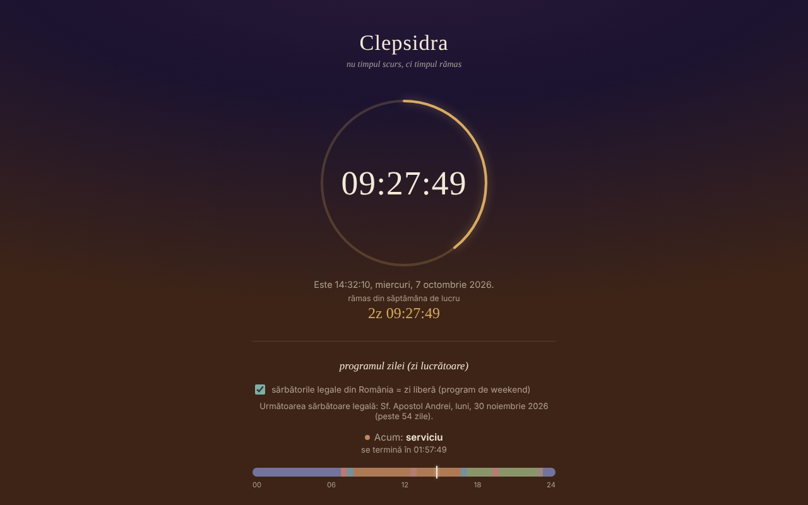

# CLEPSIDRA

Ceas invers: nu timpul scurs, ci timpul rămas din zi și din săptămână, plus alarmă și programe pentru zile lucrătoare și weekend.

**Live:** https://chiuta.github.io/CLEPSIDRA/

**Versiune:** 1.0.0 · **Ultima actualizare:** 12 octombrie 2026

## Ce este

Un singur fișier HTML, fără dependențe externe, în limba română. Arată cât a mai rămas până la miezul nopții, cât a mai rămas din săptămâna de lucru (sau din weekend), ce activitate are loc „acum” după programul tău și câte ore au mai rămas azi din fiecare categorie. Pornește „de la un gând din cartea Nemurirea, despre ceasul biologic”.

## Funcții

Verificate în cod și în teste automate (Chromium headless, ceas simulat, fus orar Europe/Bucharest):
- Numărătoare inversă până la următoarea miezul nopții, calculată pe calendarul local: în zilele cu schimbarea orei zilele durează 23 sau 25 de ore și numărătoarea o reflectă.
- Numărătoare până la sfârșitul săptămânii de lucru (sâmbătă 00:00) sau al weekendului (luni 00:00). Weekendul este fix sâmbătă–duminică; zilele de sărbătoare legală din România sunt tratate ca zile libere (bifa „sărbători legale”, activă implicit, se poate opri), cu afișarea următoarei sărbători și a numelui ei.
- Program separat pentru zile lucrătoare și weekend, cu șase categorii (somn, deplasare, serviciu, mese, timp liber, altele), bară a zilei, „acum” și timpul rămas pe categorii; editor de intervale (inclusiv peste miezul nopții). Editorul avertizează la intervale suprapuse; un interval cu început = sfârșit este ignorat.
- Evenimente: până la 6 numărători inverse către o dată și o oră alese de tine (nume până la 40 de caractere), sortate cronologic, cu timpul rămas în zile de 24 de ore (`z`) și `HH:MM:SS`; evenimentele trecute rămân afișate cu „a trecut de …” până le ștergi. Validare cu mesaje (nume lipsă, dată lipsă, limită de 6).
- Alarmă la o oră aleasă, cu opțiunea „repetă zilnic”, sunet repetat până la „oprește”, flash vizual și notificare de browser (dacă o permiți).

## Manual de utilizare

1. Deschide pagina; ceasul pornește singur.
2. Pentru program: apasă „editează programul”, alege fila „zile lucrătoare” sau „weekend”, modifică orele și categoriile sau adaugă/șterge intervale. Modificările se salvează automat în browser.
3. Pentru alarmă: alege ora, bifează sau nu „repetă zilnic” și apasă „activează” (la acest clic browserul poate cere permisiunea pentru notificări și activează sunetul).
4. Când alarma sună, apasă „oprește”.

## Confidențialitate și rețea

- Nu se face nicio cerere de rețea; fișierul nu încarcă resurse externe (are și o politică CSP restrictivă) și nu are telemetrie.
- Stocare locală (`localStorage`): `clepsidra.schedule` (programele) și `clepsidra.alarm` (ora alarmei, repetare, activă) și `clepsidra.holidays` (bifa sărbători legale) și `clepsidra.events` (evenimentele). Datele din stocare sunt validate la încărcare; dacă stocarea e blocată, aplicația merge, dar nu păstrează setările.
- Permisiuni: notificări (cerute doar la clicul pe „activează”) și sunet.

## Limite și avertismente

- **Alarma funcționează doar cât pagina rămâne deschisă și activă.** Cu fila în fundal browserele încetinesc temporizatoarele, pe telefon cu ecranul blocat sau cu pagina închisă alarma poate suna cu întârziere sau deloc (aplicația spune acest lucru și în interfață; dacă prinde alarma târziu, afișează „cu N min în urmă”). Nu o folosi ca unică alarmă pentru lucruri importante.
- Dacă pagina a fost închisă în momentul alarmei, alarma nu sună la redeschidere; se reprogramează pentru următoarea apariție a orei.
- Pe iOS/Safari sunetul este permis doar după un gest al utilizatorului: de aceea sunetul se activează la apăsarea „activează”. Nu am putut testa pe dispozitive iOS reale.
- Lista sărbătorilor urmează legislația la data verificării și poate deveni perimată dacă legea se schimbă; zilele libere ale altor culte sau cele acordate prin decizii punctuale (punți) nu sunt incluse.
- Programul implicit este un exemplu; schimbă-l după nevoie. Zilele cu schimbare de oră au bara de zi scalată la durata reală (23/25 h), dar etichetele 00–24 rămân fixe.

## Rulare locală / offline

Descarcă `index.html` și deschide-l în browser; funcționează complet fără internet.

## Istoric / Changelog

### 12 octombrie 2026 (v1.0.0)
- 1.0.0 — 2026-10-12: versiunea și data ultimei actualizări sunt afișate în aplicație

### 11 octombrie 2026 (a doua intrare)
- Funcție nouă: „evenimente” — numărători inverse către date alese de utilizator, păstrate local (testat: validare, adăugare, sortare, trecut, ștergere, persistență la reîncărcare, limita de 6).

### 11 octombrie 2026
- Verificare la 11 octombrie 2026: axe 0 violări, fără erori în consolă, fără depășire orizontală la 360 px; numărătorile se calculează dinamic din ceasul local (inclusiv schimbarea orei din 25 octombrie 2026), deci nu conțin date fixe perimate.
- Nou: sărbătorile legale ale României (listă verificată la 11 octombrie 2026 în Codul muncii art. 139 și într-o listă 2026; Paștele ortodox calculat prin algoritmul Meeus, +13 zile) contează ca zile libere în numărătoarea săptămânii; bifă de oprire, linie „următoarea sărbătoare”. Captura de ecran actualizată.

## Licență

Licența nu este încă declarată.

## Autor

Alexio — Alexandru-Ionuț Chiuță, contact: alexio@trom.tf

## English summary

CLEPSIDRA is a single-file Romanian "reverse clock": time remaining in the day and in the work week/weekend, a day schedule with separate weekday and weekend templates, and an alarm. DST days (23/25 h) are handled via calendar midnight. No network requests, no telemetry; settings are kept in localStorage and validated on load. The alarm only works while the page is open and active (it is honest about this in the UI). License not yet declared.
