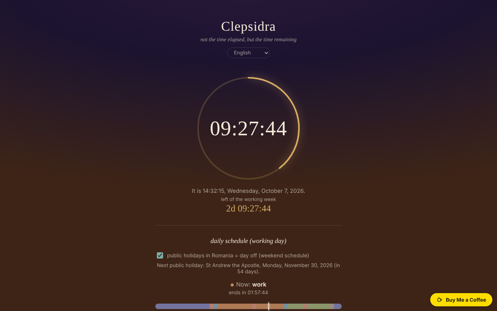

# CLEPSIDRA

**English** · [Română](README.ro.md) · [Français](README.fr.md) · [Italiano](README.it.md) · [Español](README.es.md) · [Português](README.pt.md) · [Deutsch](README.de.md) · [Magyar](README.hu.md)

**Version:** 1.2.4 · **Last updated:** 2026-10-23

Interface languages: **Română, English, Français, Italiano, Español, Português (PT), Deutsch, Magyar**

Reverse clock: not the time elapsed, but the time remaining in the day and in the week, plus an alarm and schedules for working days and weekends.

**Live:** https://chiuta.github.io/CLEPSIDRA/

## What it is

A single HTML file with no external dependencies, with an interface in 8 languages. It shows how much is left until midnight, how much is left of the working week (or of the weekend), what activity is taking place "now" according to your schedule, and how many hours are left today in each category. It starts "from a thought in the book Nemurirea, about the biological clock".

## Features

Verified in the code and in automated tests (headless Chromium, simulated clock, Europe/Bucharest time zone):
- Countdown to the next midnight, computed on the local calendar: on days with a clock change the days last 23 or 25 hours and the countdown reflects it.
- Countdown to the end of the working week (Saturday 00:00) or of the weekend (Monday 00:00). The weekend is fixed as Saturday–Sunday; public holidays in Romania are treated as days off ("public holidays" checkbox, on by default, can be turned off), with the next holiday and its name displayed.
- Separate schedules for working days and weekends, with six categories (sleep, commuting, work, meals, free time, other), a day bar, "now" and the time remaining per category; an interval editor (including across midnight). The editor warns about overlapping intervals; an interval with start = end is ignored.
- Events: up to 6 countdowns to a date and time of your choice (name up to 40 characters), sorted chronologically, with the time remaining in 24-hour days (`z`) and `HH:MM:SS`; past events stay displayed with "passed … ago" until you delete them. Validation with messages (missing name, missing date, limit of 6).
- Alarm at a chosen time, with a "repeat daily" option, a sound repeated until "stop", a visual flash and a browser notification (if you allow it).

## New features (1.1.0)

- **Calendar export (.ics)** for: the day schedule (working days / weekend, weekly repetition, hours as "floating hours", with exceptions for Romania's public holidays over 12 months), your events (with a reminder 15 minutes before) and the alarm (daily repetition if "repeat daily" is ticked). The files were checked with the Python library `icalendar` and with an independent calculation of Orthodox Easter.
- **Print / PDF of the schedule**: the print button prepares a sheet with the two schedules (working days and weekend) and the list of events; the rest of the page is not printed.
- `.fff.json` backup (shared "fff-kit" mode, local, no network): opened from the dialog that appears when you click the version in the footer (export, password-encrypted export, import with confirmation, deletion of the app data). The backup covers the `clepsidra.*` keys.
- The interface has 8 languages (RO, EN, FR, IT, ES, PT, DE, HU); the translations other than Romanian are automatic and not verified by native speakers.

## User guide

1. Open the page; the clock starts by itself.
2. For the schedule: press "edit schedule", choose the "working days" or "weekend" tab, change the hours and categories or add/delete intervals. Changes are saved automatically in the browser.
3. For the alarm: choose the time, tick or untick "repeat daily" and press "activate" (on this click the browser may ask for permission for notifications and enables the sound).
4. When the alarm rings, press "stop".

## Privacy and network

- No network request is made; the file loads no external resources (it also has a restrictive CSP policy) and has no telemetry.
- Local storage (`localStorage`): `clepsidra.schedule` (the schedules) and `clepsidra.alarm` (alarm time, repeat, active) and `clepsidra.holidays` (the public holidays checkbox) and `clepsidra.events` (the events). The data in storage is validated on load; if storage is blocked, the app works but does not keep the settings. The keys `clepsidra.schedule` and `clepsidra.events` are shared on purpose: the Orar app reads them (read-only) to import the schedules and countdowns; CLEPSIDRA never writes to Orar’s keys (`fff.orar.*`).
- The `.ics` exports and the `.fff.json` backup are generated in the browser and downloaded only when you press the buttons; they contain no data beyond the above.
- Permissions: notifications (requested only when you click "activate") and sound.

## Limits and warnings

- **The alarm works only while the page stays open and active.** With the tab in the background browsers slow down timers; on a phone with the screen locked or with the page closed the alarm may ring late or not at all (the app says this in the interface too; if it catches the alarm late, it displays "N min ago"). Do not use it as your only alarm for important things.
- If the page was closed at the time of the alarm, the alarm does not ring on reopening; it is rescheduled for the next occurrence of the time.
- On iOS/Safari sound is allowed only after a user gesture: this is why the sound is enabled when you press "activate". I could not test on real iOS devices.
- The list of holidays follows the legislation at the date of checking and may become outdated if the law changes; days off of other denominations or those granted by one-off decisions (bridge days) are not included.
- The default schedule is an example; change it as needed. Days with a clock change have the day bar scaled to the actual duration (23/25 h), but the 00–24 labels remain fixed.

## Running locally / offline

Download `index.html` and open it in a browser; it works completely without internet.

## History / Changelog

### 1.2.3 — 2026-10-22
- fff-kit 1.1.4: touch targets and minimum text size

### 1.2.2 — 2026-10-22
- fff-kit 1.1.2: PBKDF2 600,000 iterations, anti-clickjacking protection

### 14 October 2026 (v1.1.0)
- `.ics` export (schedule, events, alarm), print / PDF sheet of the schedule.
- `.fff.json` backup through the shared modules (core, label, bundle); new tests: `tests/fff-r8.test.mjs` and `tests/ics_check.py` (independent check; requires the Python package `icalendar`).

### 12 October 2026 (v1.0.0)
- 1.2.1 — 2026-10-22: the floating Buy Me a Coffee button no longer covers controls on narrow screens (it sits in the page flow); checkbox targets of 24 px; the PRODID of exported `.ics` files follows the app version; the keys shared with Orar are documented (intentional, read-only on Orar’s side). mobile and accessibility polish: text at least 12 px and touch targets at least 24 px.
- 1.0.0 — 2026-10-12: the version and the date of the last update are shown in the app

### 11 October 2026 (second entry)
- New feature: "events" — countdowns to dates chosen by the user, kept locally (tested: validation, adding, sorting, past, deletion, persistence on reload, limit of 6).

### 11 October 2026
- Check on 11 October 2026: axe 0 violations, no console errors, no horizontal overflow at 360 px; the countdowns are computed dynamically from the local clock (including the clock change of 25 October 2026), so they contain no outdated fixed dates.
- New: Romania's public holidays (list checked on 11 October 2026 in the Labour Code art. 139 and in a 2026 list; Orthodox Easter computed with the Meeus algorithm, +13 days) count as days off in the week countdown; stop checkbox, "next holiday" line. Screenshot updated.

## License

MIT License — see the `LICENSE` file.

## Author

Alexio — Alexandru-Ionuț Chiuță, contact: alexio@trom.tf

## Summary

CLEPSIDRA is a single-file "reverse clock" with an 8-language interface: time remaining in the day and in the work week/weekend, a day schedule with separate weekday and weekend templates, and an alarm. DST days (23/25 h) are handled via calendar midnight. No network requests, no telemetry; settings are kept in localStorage and validated on load. The alarm only works while the page is open and active (it is honest about this in the UI). License not yet declared.
