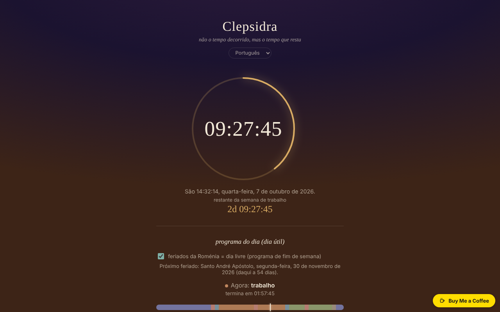

# CLEPSIDRA

[English](README.md) · [Română](README.ro.md) · [Français](README.fr.md) · [Italiano](README.it.md) · [Español](README.es.md) · **Português** · [Deutsch](README.de.md) · [Magyar](README.hu.md)

**Versão:** 1.2.5 · **Última atualização:** 2026-10-23

Idiomas da interface: **Română, English, Français, Italiano, Español, Português (PT), Deutsch, Magyar**

Relógio inverso: não o tempo decorrido, mas o tempo que resta do dia e da semana, além de um alarme e de horários para os dias úteis e o fim de semana.

**Online:** https://chiuta.github.io/CLEPSIDRA/

## O que é

Um único ficheiro HTML, sem dependências externas, com interface em 8 idiomas. Mostra quanto falta para a meia-noite, quanto resta da semana de trabalho (ou do fim de semana), que atividade decorre «agora» segundo o seu horário e quantas horas restam hoje em cada categoria. Parte «de um pensamento do livro Nemurirea, sobre o relógio biológico».

## Funcionalidades

Verificadas no código e em testes automáticos (Chromium headless, relógio simulado, fuso horário Europe/Bucharest):
- Contagem decrescente até à próxima meia-noite, calculada no calendário local: nos dias com mudança de hora os dias duram 23 ou 25 horas e a contagem reflete-o.
- Contagem decrescente até ao fim da semana de trabalho (sábado 00:00) ou do fim de semana (segunda-feira 00:00). O fim de semana é fixo, sábado–domingo; os feriados legais da Roménia são tratados como dias livres (caixa «feriados legais», ativa por predefinição, pode ser desativada), com apresentação do próximo feriado e do seu nome.
- Horário separado para os dias úteis e o fim de semana, com seis categorias (sono, deslocação, trabalho, refeições, tempo livre, outros), barra do dia, «agora» e tempo restante por categoria; editor de intervalos (incluindo através da meia-noite). O editor avisa em caso de intervalos sobrepostos; um intervalo com início = fim é ignorado.
- Eventos: até 6 contagens decrescentes para uma data e hora à sua escolha (nome até 40 carateres), ordenadas cronologicamente, com o tempo restante em dias de 24 horas (`z`) e `HH:MM:SS`; os eventos passados continuam visíveis com «passou há …» até os eliminar. Validação com mensagens (nome em falta, data em falta, limite de 6).
- Alarme a uma hora escolhida, com a opção «repetir diariamente», som repetido até «parar», flash visual e notificação do navegador (se a permitir).

## Novidades (1.1.0)

- **Exportação de calendário (.ics)** de: o horário do dia (dias úteis / fim de semana, repetição semanal, horas como «horas flutuantes», com exceções para os feriados legais da Roménia durante 12 meses), os seus eventos (com lembrete 15 minutos antes) e o alarme (repetição diária se «repetir diariamente» estiver assinalado). Os ficheiros foram verificados com a biblioteca Python `icalendar` e com um cálculo independente da Páscoa ortodoxa.
- **Impressão / PDF do horário**: o botão de impressão prepara uma folha com os dois horários (dias úteis e fim de semana) e a lista de eventos; o resto da página não é impresso.
- Cópia de segurança `.fff.json` (modo comum «fff-kit», local, sem rede): abre-se a partir da caixa de diálogo que surge ao clicar na versão no rodapé (exportação, exportação cifrada com palavra-passe, importação com confirmação, eliminação dos dados da aplicação). A cópia abrange as chaves `clepsidra.*`.
- A interface tem 8 idiomas (RO, EN, FR, IT, ES, PT, DE, HU); as traduções que não sejam romeno são automáticas e não verificadas por falantes nativos.

## Manual de utilização

1. Abra a página; o relógio arranca sozinho.
2. Para o horário: prima «editar horário», escolha o separador «dias úteis» ou «fim de semana», altere as horas e as categorias ou adicione/elimine intervalos. As alterações são guardadas automaticamente no navegador.
3. Para o alarme: escolha a hora, assinale ou não «repetir diariamente» e prima «ativar» (neste clique o navegador pode pedir permissão para notificações e ativa o som).
4. Quando o alarme tocar, prima «parar».

## Privacidade e rede

- Não é feito nenhum pedido de rede; o ficheiro não carrega recursos externos (tem também uma política CSP restritiva) e não tem telemetria.
- Armazenamento local (`localStorage`): `clepsidra.schedule` (os horários) e `clepsidra.alarm` (hora do alarme, repetição, ativo) e `clepsidra.holidays` (a caixa dos feriados legais) e `clepsidra.events` (os eventos). Os dados do armazenamento são validados no carregamento; se o armazenamento estiver bloqueado, a aplicação funciona, mas não guarda as definições. As chaves `clepsidra.schedule` e `clepsidra.events` são partilhadas de propósito: a aplicação Orar lê-as (só leitura) para importar os horários e as contagens decrescentes; a CLEPSIDRA nunca escreve nas chaves do Orar (`fff.orar.*`).
- As exportações `.ics` e a cópia `.fff.json` são geradas no navegador e descarregadas apenas quando prime os botões; não contêm dados além dos indicados acima.
- Permissões: notificações (pedidas apenas ao clicar em «ativar») e som.

## Limites e avisos

- **O alarme só funciona enquanto a página permanecer aberta e ativa.** Com o separador em segundo plano os navegadores abrandam os temporizadores; no telemóvel com o ecrã bloqueado ou com a página fechada o alarme pode tocar com atraso ou não tocar (a aplicação di-lo também na interface; se apanhar o alarme tarde, apresenta «há N min»). Não o use como único alarme para coisas importantes.
- Se a página estava fechada no momento do alarme, este não toca ao reabrir; é reagendado para a próxima ocorrência da hora.
- No iOS/Safari o som só é permitido após um gesto do utilizador: por isso o som é ativado ao premir «ativar». Não foi possível testar em dispositivos iOS reais.
- A lista de feriados segue a legislação à data da verificação e pode ficar desatualizada se a lei mudar; não estão incluídos os dias livres de outros cultos nem os concedidos por decisões pontuais (pontes).
- O horário predefinido é um exemplo; altere-o conforme necessário. Nos dias com mudança de hora a barra do dia é escalada à duração real (23/25 h), mas as etiquetas 00–24 permanecem fixas.

## Execução local / offline

Descarregue `index.html` e abra-o no navegador; funciona totalmente sem internet.

## Histórico / Changelog

### 1.2.3 — 2026-10-22
- fff-kit 1.1.4: alvos de toque e tamanho mínimo do texto

### 1.2.2 — 2026-10-22
- fff-kit 1.1.2: PBKDF2 600 000 iterações, proteção anti-clickjacking

### 14 de outubro de 2026 (v1.1.0)
- Exportação `.ics` (horário, eventos, alarme), folha de impressão / PDF do horário.
- Cópia `.fff.json` através dos módulos comuns (core, label, bundle); novos testes: `tests/fff-r8.test.mjs` e `tests/ics_check.py` (verificação independente; requer o pacote Python `icalendar`).

### 12 de outubro de 2026 (v1.0.0)
- 1.2.1 — 2026-10-22: o botão flutuante Buy Me a Coffee já não tapa os controlos em ecrãs estreitos (fica no fluxo da página); caixas de seleção de 24 px; o PRODID dos `.ics` exportados segue a versão da aplicação; as chaves partilhadas com o Orar estão documentadas (intencional, só leitura do lado do Orar). melhorias para telemóvel e acessibilidade: texto de pelo menos 12 px e áreas táteis de pelo menos 24 px.
- 1.0.0 — 2026-10-12: a versão e a data da última atualização são apresentadas na aplicação

### 11 de outubro de 2026 (segunda entrada)
- Funcionalidade nova: «eventos» — contagens decrescentes para datas escolhidas pelo utilizador, guardadas localmente (testado: validação, adição, ordenação, passado, eliminação, persistência ao recarregar, limite de 6).

### 11 de outubro de 2026
- Verificação de 11 de outubro de 2026: axe 0 violações, sem erros na consola, sem excesso horizontal a 360 px; as contagens são calculadas dinamicamente a partir do relógio local (incluindo a mudança de hora de 25 de outubro de 2026), pelo que não contêm datas fixas desatualizadas.
- Novo: os feriados legais da Roménia (lista verificada a 11 de outubro de 2026 no Código do Trabalho art. 139 e numa lista de 2026; Páscoa ortodoxa calculada pelo algoritmo de Meeus, +13 dias) contam como dias livres na contagem da semana; caixa para os desativar, linha «próximo feriado». Captura de ecrã atualizada.

## Licença

Licença MIT — ver o ficheiro `LICENSE`.

## Autor

Alexio — Alexandru-Ionuț Chiuță, contacto: alexio@trom.tf

## Resumo

A CLEPSIDRA é um «relógio inverso» de ficheiro único, com interface em 8 idiomas: tempo restante do dia e da semana de trabalho/fim de semana, um horário diário com modelos separados para os dias úteis e o fim de semana, e um alarme. Os dias com mudança de hora (23/25 h) são tratados através da meia-noite do calendário. Sem pedidos de rede, sem telemetria; as definições são guardadas em localStorage e validadas no carregamento. O alarme só funciona enquanto a página está aberta e ativa (a aplicação é franca quanto a isso na interface). Licença ainda não declarada.
